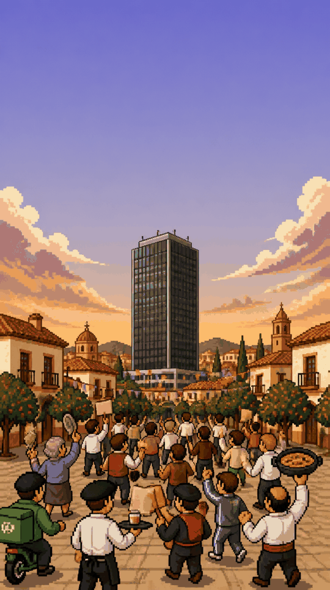
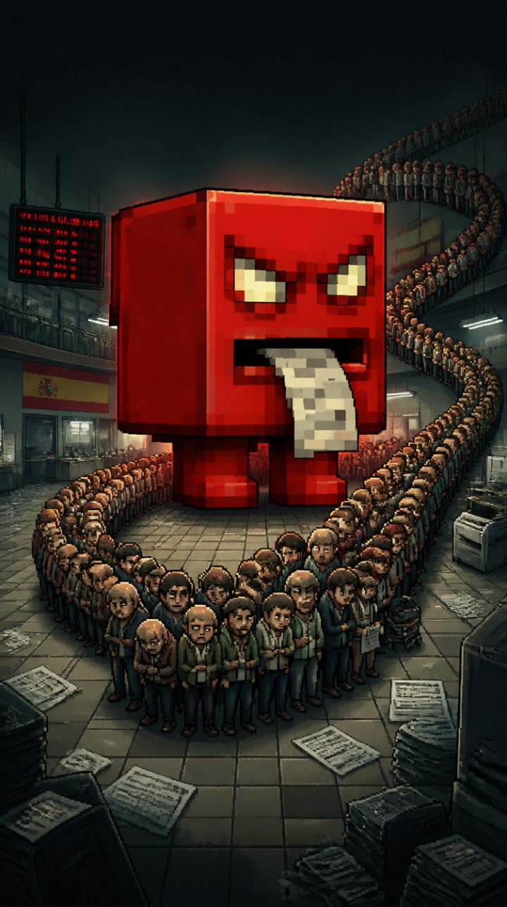
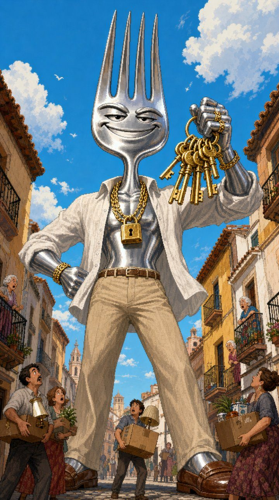
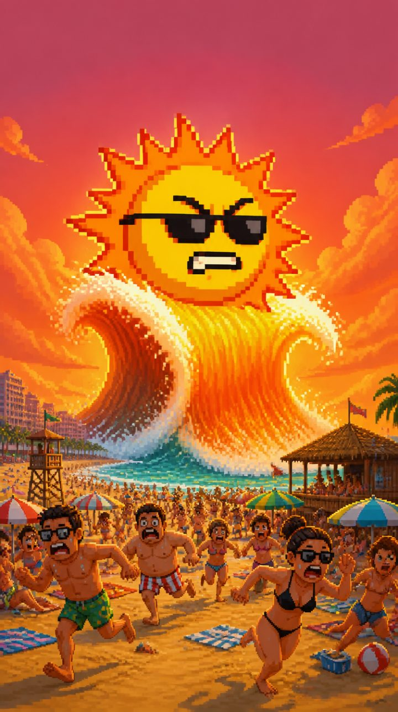
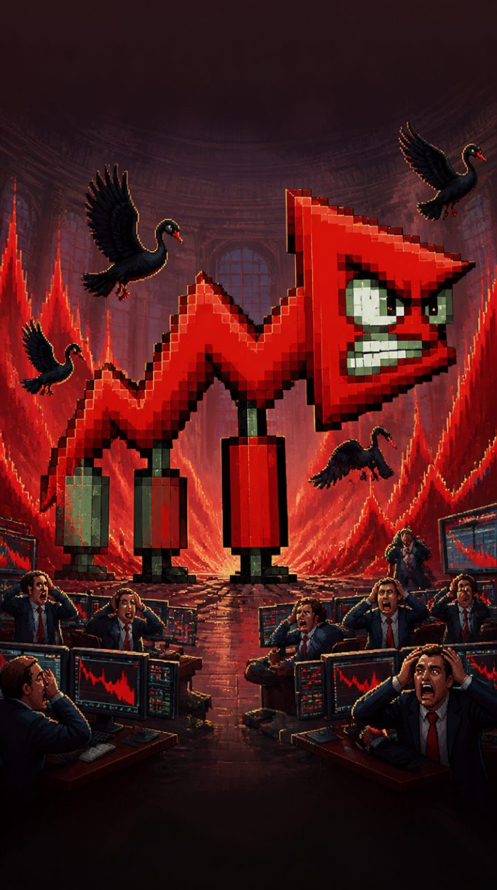
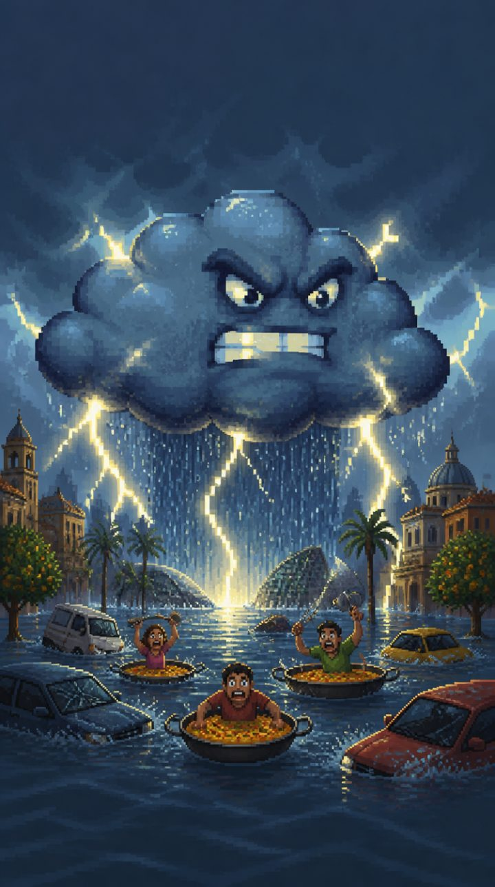
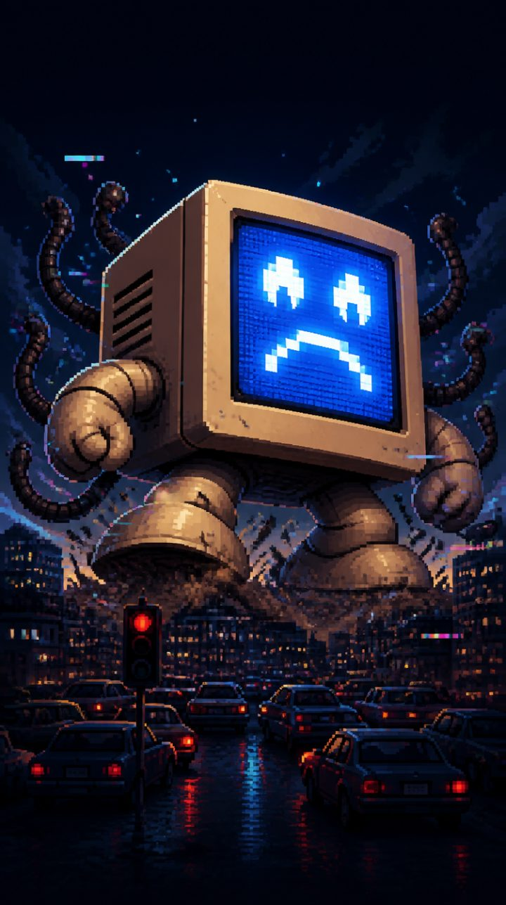

  

<h1 align="center">¿Cuántos hacemos falta?</h1>

<i>Españoles muy españoles más españoles</i>

  <a href="https://nawebaz.github.io/CHF_GAME/"><b>Jugar en el navegador</b></a> ·
  <a href="https://chfgame.itch.io/cuantos-hacemos-falta">itch.io</a> ·
  <a href="https://ko-fi.com/chfgame">Invitar a un café</a>

**¿Cuántos hacemos falta?** (CHF) es un autobattler satírico, gratis y en el navegador, sobre la España de la última década. Tú montas la cuadrilla; ellos pelean solos. La pregunta es siempre la misma: ¿cuántos hacemos falta para tumbar al sistema?

## Cómo se juega

- Fichas a gente de a pie en la tienda: abuelas, funcionarios, cajeras, agricultores, riders, frikis, mecánicos, cuñados… Más de 30 clases.
- Les das objetos. Si una clase junta sus tres objetos propios, desata su ataque especial de recreativa.
- Pelean solos contra olas de enemigos y jefes. Tú decides a quién llevas, no cómo pega.
- Si pierdes, te jubilas: lo que cotizas sirve para desbloquear mejoras en la siguiente partida.

Cuatro dificultades: becario, mileurista, autónomo y Hacienda. Partidas de 20 a 30 minutos. Funciona en el móvil y en el ordenador, sin descargar nada.

## Algunos jefes

  
  
  
  
  
  

La cola del paro, el gran tenedor, la ola de calor, la prima de riesgo, la nube, el pantallazo azul… y, al final, un perro muy bien trajeado. Por el camino, un cuñao te da consejos que nadie le ha pedido (se le puede callar).

## Cómo está hecho

Lo hace **Nawe**, un audiovisual de Málaga con 12 años de oficio detrás de la cámara y ninguno como programador. CHF es una prueba de hasta dónde llega una persona creativa con una IA potente y pocos recursos.

Sin trampa:

- Las ideas, la sátira, el diseño, la dirección de arte y las decisiones son de Nawe.
- Los sprites y las ilustraciones se generan con IA y se limpian y montan a mano.
- El código se escribe con un asistente de IA (Claude).

La sátira va contra la gestión y el sistema, nunca contra la gente: no aparecen nombres ni caras reales.

## Ficha

| Dato | Valor |
| --- | --- |
| Género | Autobattler satírico con progresión entre partidas |
| Estilo | Pixel art de 16 bits |
| Plataforma | Navegador (HTML5), móvil y ordenador |
| Idioma | Español de España |
| Precio | Gratis; donaciones opcionales en [Ko-fi](https://ko-fi.com/chfgame) |
| Público | Mayores de 16 años |

## Fallos, ideas y opiniones

Si algo falla o tienes una idea, cuéntalo en [Discussions](https://github.com/Nawebaz/CHF_GAME/discussions). No hace falta saber programar.

## Licencia

El código se puede leer, estudiar y reutilizar para usos no comerciales ([PolyForm Noncommercial 1.0.0](LICENSE)). El arte, los textos del juego, el nombre y la marca CHF tienen todos los derechos reservados: no se permite volver a publicar el juego en otros sitios. Detalles en [NOTICE.md](NOTICE.md).

## English

**How Many Of Us Does It Take?** A free, browser-based satirical autobattler about Spain's last decade. Recruit everyday people (grandmas, civil servants, cashiers, delivery riders, the know-it-all brother-in-law…), give them items and watch them take on the system: the unemployment line, the mega-landlord, the heatwave, the risk premium. Made by Nawe, an audiovisual professional from Málaga, with AI-generated art and an AI coding assistant; ideas, satire and design are his. **The game text is in Spanish.**
